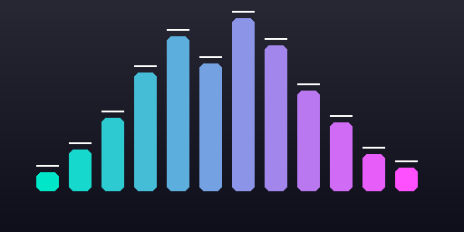

# DeckWave 🌊

**Real-Time Audio Visualizer Wave Bar Plugin for StreamController**  
*Built for Elgato Stream Deck XL, Stream Deck +, and Stream Deck MK.2.*

[](https://github.com/Core447/StreamController)
[](https://opensource.org/licenses/MIT)
[](#)

---



## Overview

**DeckWave** turns your entire Stream Deck into a responsive, high-performance audio frequency visualizer wave bar. Each vertical column of physical LCD keys acts as an equalizer frequency band—spanning from deep sub-bass on the left to sparkling highs on the right.

Designed specifically for **Linux & PipeWire**, DeckWave lets you visualize master system audio or isolate specific running applications (such as Spotify, Discord, or your browser).

---

## ✨ Features

- **Full-Deck Multi-Key Bars**: Vertical columns across 2, 3, or 4 keys form seamless continuous frequency bars.
- **Smart Hardware Page Provisioning**: Automatically detects your connected Stream Deck hardware (e.g. **Stream Deck XL** and **Stream Deck +**) and only provisions page templates for active models, keeping your Page Manager clean and clutter-free.
- **Multi-Stop Gradient Engine**:
  - **1-Color (Solid)**
  - **2-Color Gradient**
  - **3-Color Gradient**
  - **4-Color Gradient**
  - **5-Color Gradient** (Sub-bass base $\to$ Mid $\to$ Peak)
- **Bar Styles**:
  - **Solid Bar**: Smooth continuous fluid wave bars.
  - **Stepped LEDs**: Vintage graphic equalizer segmented LED blocks with inactive dark outlines.
  - **Peak Hold Caps**: Floating peak indicator line with realistic gravity decay.
- **Dynamic Application Audio Targeting**: Choose between Default System Audio or target active PipeWire audio streams (Spotify, Firefox, Chrome, VLC, Discord).
- **Zero-Configuration Coordinates**: Key actions deduce their column (frequency band) and row (vertical slice) automatically using hardware grid detection.
- **Ultra-Low Overhead**: Intelligent dirty-key caching skips sending frames over USB when levels are stationary, keeping CPU usage under 2% and Stream Deck response instant.

---

## 🎛️ Hardware Layout Support

| Device | Grid Layout | Frequency Columns | Vertical Height per Bar |
| :--- | :--- | :--- | :--- |
| **Stream Deck XL** | 8 cols × 4 rows | **8 bands** (Full octave spectrum) | **4 keys** ($384\text{ px}$) |
| **Stream Deck +** | 4 cols × 2 rows | **4 bands** (+ Touch Bar aligned) | **2 keys** ($240\text{ px}$) |
| **Stream Deck MK.2** | 5 cols × 3 rows | **5 bands** (Sub, Bass, Mid, Hi-Mid, Treble) | **3 keys** ($216\text{ px}$) |

---

## 🚀 Installation

### Via StreamController Plugins Folder

1. Clone or symlink this repository into your StreamController plugins directory:
   ```bash
   # Flatpak installation (standard)
   ln -s "/home/oscar/Github Projects/DeckWave" ~/.var/app/com.core447.StreamController/data/plugins/com_oparada1988_DeckWave
   ```
2. Restart StreamController.
3. Add the **DeckWave Launcher** action to any button on your main page.

---

## ⚙️ Configuration

Open the action settings on the **DeckWave Launcher** button:
1. **Audio Source**: Select *Default System Audio* or pick a detected app like *Spotify* (use the `🔄` button to refresh running apps).
2. **Gain / Sensitivity**: Boost or attenuate incoming audio amplitude ($0.5\times$ to $3.0\times$).
3. **Decay Speed**: Choose *Fast*, *Normal*, or *Slow* falloff physics.
4. **Color Mode**: Choose between Solid or 2, 3, 4, or 5-stop gradients with custom hex color pickers.
5. **Bar Background & Peak Colors**: Customize unfilled space and floating peak tick colors.
6. **Provision Pages**: Click to automatically create the dedicated visualizer page matching your connected deck model.

---

## 🎮 Navigation & Exit

* **Launch**: Press the **DeckWave Launcher** button on your everyday page to jump into the full-deck visualizer.
* **Exit**: Tap **any visualizer key** (or the dedicated return key) to immediately switch back to your previous page. Audio processing automatically pauses when leaving the visualizer page.

---

## 📄 License

Distributed under the **MIT License**. See [`LICENSE`](LICENSE) for details.
